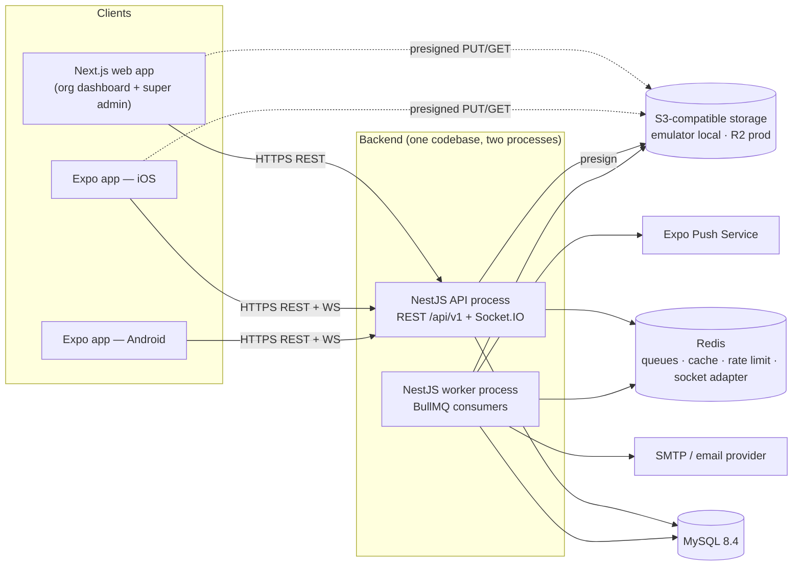

# 01 — System Architecture

Status: PROPOSED (Phase 0). Decisions referenced as D1…D17 are in [00-DECISIONS](00-DECISIONS.md).

## 1. System context



**Boundaries.** Clients only talk to the API (and to object storage through URLs the API issued). Only the API and worker touch MySQL. The worker shares the API's code (modules, Prisma schema) but runs as its own process so slow jobs never block requests. There are no other services in the MVP (no microservices, D1/D3 notes).

**Out of scope for the MVP:** payments, video calls, wearables integration, AI features, offline-first sync, a marketing website.

## 2. Repository strategy (D1)

```
.
├── apps/
│   ├── api/            # NestJS: API process + worker entrypoint
│   ├── web/            # Next.js App Router
│   └── mobile/         # Expo + Expo Router
├── packages/
│   ├── domain/         # PURE TypeScript rules (no I/O): permission catalog types, progress math, fitness calculations
│   ├── api-client/     # generated from OpenAPI + fetch wrapper + ApiError (used by web and mobile)
│   ├── validation/     # Zod form schemas (UX-level mirrors of DTO rules)
│   ├── i18n/           # JSON dictionaries (en, ar), ICU helpers, parity tests
│   ├── ui-tokens/      # design tokens (colors, radii, spacing) as JSON → CSS vars and RN theme
│   └── config/         # shared eslint, tsconfig, prettier
├── docs/               # this folder; ARCHITECTURE checklist, HANDOVER.md
├── infra/              # docker-compose files, Caddyfile, backup scripts, CI helpers
├── .github/workflows/
├── pnpm-workspace.yaml · turbo.json · package.json · .env.example
```

Rules:
- `packages/domain` may import nothing from apps. It runs on server, web and mobile; almost everything in it is unit-testable without a framework.
- `apps/*` never import from each other. Anything shared is promoted to a package.
- Enforced with `eslint-plugin-boundaries` (or `dependency-cruiser`) in CI.
- Node 22 LTS, TypeScript strict everywhere, one lockfile.

## 3. Backend: NestJS modular monolith

### 3.1 Layers (dependency direction is one-way)

```
modules/*   (business-specific: fitness, later education…)   may import ↓
capabilities/*   (shared business capabilities)               may import ↓
core/*   (identity, tenancy, RBAC, audit, platform admin)     may import ↓
infra/*  (prisma, redis, queue, storage, mail, push, logging)
common/* (filters, pipes, decorators, request context)
```

A lower layer **never imports** a higher one. `capabilities` expose services and emit events; `modules` consume them. Cross-module communication uses typed domain events (`task.completed`, `checkin.submitted`) through Nest's event emitter and BullMQ for async work. This is what lets Education be added without modifying core, and lets a module be extracted later.

### 3.2 Folder structure

```
apps/api/src/
├── main.ts                  # API bootstrap (helmet, CORS, versioning, Swagger, pipes, filters)
├── worker.ts                # worker bootstrap (same modules, queue consumers only)
├── app.module.ts
├── config/                  # typed config; zod-validated env at boot; the ONLY place reading process.env
├── common/
│   ├── context/             # RequestContext in AsyncLocalStorage (userId, orgId, membershipId, permissions, requestId)
│   ├── decorators/          # @CurrentUser @CurrentOrg @RequirePermission @RequiresModule @Public
│   ├── errors/              # AppError(code, status), error code registry, ApiExceptionFilter
│   ├── interceptors/        # logging, audit, idempotency
│   ├── pipes/               # ValidationPipe config (whitelist, forbidNonWhitelisted, transform)
│   └── pagination/          # cursor + page helpers, DTOs
├── infra/
│   ├── prisma/              # PrismaService (unscoped, allow-listed), TenantPrismaService (scoped)
│   ├── redis/ queue/ storage/ mail/ push/ logging/ health/
├── core/
│   ├── auth/                # register, login, refresh rotation, sessions, email verify, reset, MFA (TOTP)
│   ├── users/               # profile, preferences, devices
│   ├── organizations/       # org CRUD, settings, module enablement
│   ├── memberships/         # members, status, assignments (practitioner ↔ participant), groups
│   ├── invitations/
│   ├── rbac/                # permission catalog sync, roles, policy engine, guards
│   ├── audit/               # AuditService, append-only audit_logs
│   ├── platform-admin/      # super-admin API: stats, users, orgs, categories, modules, platform roles
│   └── me/                  # /me/context: memberships, permissions, enabled modules, navigation
├── capabilities/
│   ├── tasks/  progress/  files/  messaging/  notifications/  activity/  reports/
└── modules/
    ├── module-registry/     # BusinessModuleManifest registry
    └── fitness/             # see 3.3
```

Inside each feature folder: `*.module.ts`, `controllers/`, `services/` (application logic), `policies/` (who may do what to which resource), `repositories/` (Prisma access via the tenant-scoped client), `dto/` (class-validator, Swagger-annotated), `events/`, `*.spec.ts`. Controllers only map HTTP to service calls. Services hold orchestration. Pure calculations go to `packages/domain`. Files stay under roughly 300 lines.

### 3.3 Business module contract

Every business module exports a **manifest** that the platform reads; the core never imports fitness code.

```ts
interface BusinessModuleManifest {
  key: 'fitness' | 'education' | …;
  permissions: PermissionDefinition[];          // synced into `permissions` table at boot (idempotent)
  roleDefaults: Record<RoleKey, GrantDefinition[]>; // default grants for system role templates
  metricDefinitions: MetricDefinitionSeed[];    // e.g. weight_kg, waist_cm
  navigation: NavItem[];                        // permission-aware menu items for web and mobile
  dashboardWidgets: WidgetDefinition[];
  eventHandlers: …;                             // listens to capability events
}
```

Routes of a module are guarded by `@RequiresModule('fitness')` (organization must have it enabled **and** the platform must not have disabled it) plus `@RequirePermission(...)`. Clients call `GET /api/v1/orgs/:orgId/me/context` and render navigation from the response, so adding a module requires no hard-coded menus in either app.

### 3.4 Request pipeline

```
request → helmet/CORS → requestId → rate limit (Redis) → JwtAuthGuard
        → OrgContextGuard (active membership + org ACTIVE, builds RequestContext)
        → ModuleEnabledGuard → PermissionsGuard (permission + grant scope)
        → ValidationPipe → controller → service → policy check on the resource
        → tenant-scoped repository → MySQL
        errors → ApiExceptionFilter → { error: { code, message, details?, requestId } }
        side effects → audit interceptor/service, domain events, BullMQ jobs
```

### 3.5 Background jobs

Queues: `notifications`, `email`, `push`, `file-processing`, `maintenance` (token cleanup, reminders, scheduled check-in nudges). Jobs carry ids, never PII payloads. Jobs are idempotent (job id derived from the event) and retried with backoff; failures land in a dead-letter queue visible to super admin. The worker is started with `node dist/worker.js`; in development both run in one process.

### 3.6 Logging, errors, config

`nestjs-pino`: JSON logs, `requestId` propagated into jobs, secrets and PII redacted. One global exception filter; unknown errors become `INTERNAL_ERROR` with the request id and are never leaked. Config is validated with Zod at boot; the app refuses to start with missing secrets. `/health/live` is open and trivial; `/health/ready` (MySQL, Redis, storage) is internal.

## 4. API conventions

| Topic | Convention |
| --- | --- |
| Base | `/api/v1`. Auth: `/auth/*`. Self: `/me/*`. Org-scoped: `/orgs/:orgId/*`. Platform admin: `/admin/*` |
| Resources | Plural nouns, kebab-case: `/orgs/:orgId/fitness/workout-plans/:planId/versions` |
| Methods | `GET` read, `POST` create/actions (`POST …/:id/assign`), `PATCH` partial update, `DELETE` remove/archive |
| Success | `200/201` with `{ "data": …, "meta"?: … }`; `204` for no content |
| Errors | `{ "error": { "code": "TASK_NOT_FOUND", "message": "English fallback", "details"?: …, "requestId": "…" } }`; stable machine codes; clients localize by code |
| Status | `400` validation, `401` unauthenticated, `403` authenticated but not allowed **inside** the tenant, `404` not found **or outside the tenant**, `409` conflict/version, `422` business rule, `429` rate limit |
| Pagination | Cursor by default: `?limit=25&cursor=…` → `meta.nextCursor`. Offset (`page`, `pageSize`, `total`) only for admin tables |
| Filtering/sorting | `?filter[status]=open&sort=-createdAt`, whitelisted per endpoint |
| Time | ISO 8601 UTC. Local-day concepts (check-in week) use the org timezone and are sent as dates (`2026-11-09`) |
| Concurrency | Editable aggregates (plans, tasks) carry `version`; clients send `If-Match`/`version`; mismatch → `409` |
| Idempotency | `Idempotency-Key` header on creating POSTs that mobile may retry (check-ins, uploads, logs) |
| Uploads | `POST /files/uploads` (returns presigned PUT) → client uploads → `POST /files/:id/complete` |
| Docs | Swagger at `/api/docs` (non-production or admin-only), every DTO and error documented |
| Versioning | URI major version; additive changes only inside `v1`; breaking → `v2` |

## 5. Web application: Next.js App Router

```
apps/web/src/
├── app/
│   ├── [locale]/                      # en | ar, sets <html lang dir>
│   │   ├── (public)/                  # login, register, accept-invite, forgot/reset password
│   │   ├── (account)/                 # profile, security (sessions, MFA), organization picker
│   │   ├── (org)/o/[orgSlug]/         # org dashboard shell (permission-aware sidebar from /me/context)
│   │   │   ├── page.tsx               # overview
│   │   │   ├── members/ invitations/ groups/ tasks/ progress/ reports/ settings/ roles/ audit/
│   │   │   └── fitness/               # clients, workout-plans, nutrition-plans, check-ins (module routes)
│   │   └── (admin)/admin/             # super admin: stats, users, organizations, categories, modules, roles, audit, health
│   └── api/                           # only tiny route handlers if needed (e.g. cookie refresh proxy)
├── features/<name>/                   # components, hooks (TanStack Query), view-models, forms
├── components/ui/                     # shadcn/ui-based kit: Button, Card, Field, Dialog, Tabs, Badge, Toast, ConfirmButton…
├── lib/                               # api client instance, auth store (in-memory token), permission helpers
├── providers/                         # QueryClient, Auth, Theme, Intl
└── styles/                            # tokens.css, base.css
```

- Authenticated screens render **client-side** with TanStack Query (no SEO need; avoids server-side cookie/token juggling). Server components are used for layouts, i18n and static parts.
- `<Can permission="task.create" scope="…">` and route guards read the context from `/me/context`; the backend still enforces everything.
- The super admin lives in its own route group, layout and guard; it shares the UI kit but not the org shell, and a user who is both org owner and super admin sees two clearly separate experiences.
- Forms: React Hook Form + Zod from `packages/validation`; API validation errors map back to fields by `details`.
- RTL: logical Tailwind utilities only; `dir` on `<html>`; code, ids, emails stay `dir="ltr"`; Arabic gets taller line-height and no negative letter-spacing (blueprint lessons).

## 6. Mobile application: Expo + React Native

```
apps/mobile/
├── app/                               # Expo Router
│   ├── _layout.tsx                    # providers, auth gate, i18n/RTL bootstrap
│   ├── (auth)/ login · register · accept-invite · forgot-password
│   ├── select-organization.tsx
│   └── (app)/
│       ├── _layout.tsx                # tabs built from /me/context navigation
│       ├── (tabs)/ home · tasks · progress · messages · more
│       ├── fitness/ workouts · nutrition · check-in · photos · clients (trainer)
│       └── profile/ settings · security · notifications · language
├── src/
│   ├── features/<name>/               # screens' components + TanStack Query hooks
│   ├── components/ui/                 # themed primitives from ui-tokens
│   ├── lib/                           # apiClient (token refresh interceptor), secureStorage, push registration, uploader
│   ├── stores/                        # Zustand: active organization, UI preferences (persisted, non-sensitive)
│   └── i18n/                          # i18next config over packages/i18n
├── app.config.ts · eas.json
```

- Tokens in `expo-secure-store`; Zustand holds only non-sensitive state (active org id, theme, language).
- One shared navigation shell driven by `/me/context`; a trainer and a client use the same app with different tabs and permissions. No per-role apps.
- Photo flow: `expo-image-picker` → `expo-image-manipulator` (resize/compress) → presigned PUT with `expo-file-system` upload.
- RTL: `I18nManager` direction changes need an app reload (`expo-updates` `reloadAsync`); the language switcher handles that and is covered by a device test in Phase 4.
- Push: `expo-notifications` registers the Expo push token to `/me/devices`; deep links open the right screen.
- Builds with EAS (watch build-minutes cost); OTA updates only for JS-level fixes and with code signing.

## 7. Shared versus business-specific: how to decide

Put it in **core/capabilities** only if **all** are true: (1) it makes sense for at least two industries, (2) it contains no domain vocabulary (workout, grade, lesson), (3) its tables can be keyed by organization and membership alone.

| Concern | Lives in | Why |
| --- | --- | --- |
| Users, orgs, memberships, invitations, roles, audit | core | every industry |
| Tasks, goals/milestones, metric time series, files, messaging, notifications, activity feed, groups, practitioner ↔ participant assignment | capabilities | reusable; no industry vocabulary |
| Exercises, workout/nutrition plans and logs, check-ins, progress photos, client fitness profile | `modules/fitness` (`fit_*` tables) | industry vocabulary |
| Classes, lessons, grades, attendance, guardians' views | `modules/education` (later, `edu_*`) | industry vocabulary |

**Adding a new module (checklist):** create `modules/<key>/` with a manifest → add `<prefix>_*` tables via Prisma migration → register permissions and navigation → add category-to-module default → add i18n namespace → write policy tests. Nothing under `core/` or `capabilities/` changes.

## 8. Infrastructure and deployment

**Local development (Docker Compose):** `mysql:8.4`, `redis:7`, `mailpit` (captures email); an S3-compatible emulator is added in Phase 5. API, worker and web run on the host with hot reload (or as compose services via a profile). `pnpm dev` starts everything; `pnpm db:migrate` / `db:seed`.

**Environments:** `local`, `staging` (same compose topology, smaller VPS), `production`. Config only through environment variables; secrets via the host's secret store (never in the repo; `.env.example` lists every variable).

**MVP production (D12):** one VPS with Caddy (automatic TLS) → `web`, `api`, `worker`, `mysql`, `redis`; Cloudflare R2 for files and backups; DNS split `app.` (web) and `api.` under one parent domain (needed for the refresh cookie). Migrations run as a one-shot `prisma migrate deploy` step before new containers start, never from every replica.

**CI/CD (GitHub Actions):** install with pnpm cache → lint → typecheck → unit tests → integration tests (MySQL + Redis service containers) → OpenAPI client drift check → build images → push to GHCR → deploy to staging automatically, production on tag with manual approval. Turborepo remote cache optional.

**Backups and recovery:** nightly encrypted `mysqldump --single-transaction` + binary logs for point-in-time recovery, shipped to R2 with lifecycle rules; R2 bucket versioning for files; **a scheduled job restores the latest dump into a scratch database and runs sanity checks weekly**. Targets: RPO ≤ 15 min (binlogs), RTO ≤ 4 h. Written runbook in `docs/RUNBOOK.md` (Phase 10, backups themselves in Phase 1).

**Observability (cost-conscious):** structured logs to files + Docker log driver; Sentry free tier for errors (web, api, mobile); uptime monitor on `/health/live`; BullMQ dashboard behind super admin; Grafana/Loki or a managed log service when traffic justifies it.

**Cost levers:** R2 instead of S3 (no egress), Expo Push (free), single VPS, no managed Redis, Vercel not required for the web app (self-hosted `next start` in Docker). Re-check provider prices when you decide; I will not assume figures.

## 9. Frontend–backend alignment rules

1. Business rules live in the API (or `packages/domain` when they are pure and needed for display). Web and mobile never re-implement authorization or workflow logic.
2. Clients show or hide UI from `/me/context`; the server enforces on every call.
3. One generated API client; no hand-written fetch calls in features.
4. One error path: API error → `ApiError(code)` → localized message → toast/field error.
5. Every destructive action uses a two-step "arm to confirm" button (blueprint), plus server-side audit.
