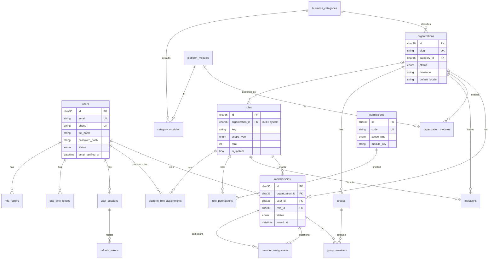
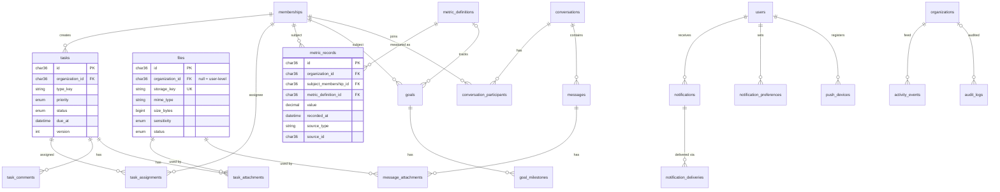
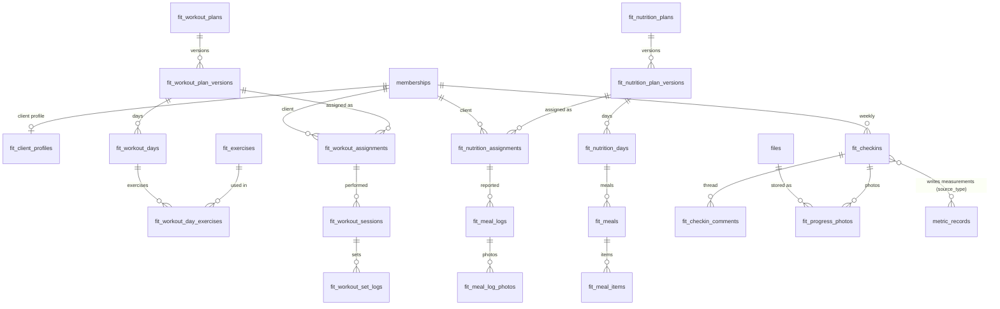

# 02 — Database Design (MySQL 8.4 + Prisma)

Status: PROPOSED (Phase 0). About 60 tables. Platform/core and capability tables have no industry vocabulary; Fitness tables are prefixed `fit_`.

## 1. Conventions

| Topic | Rule |
| --- | --- |
| Names | tables `snake_case` plural; columns `snake_case`; Prisma models `PascalCase` with `@@map`/`@map` |
| IDs | UUIDv7 `CHAR(36)` generated by the app (D8). Timestamps `DATETIME(3)` in UTC: `created_at`, `updated_at` on every table |
| Charset | `utf8mb4`, collation `utf8mb4_0900_ai_ci`; emails stored lowercased |
| Tenant column | every tenant-owned table has `organization_id CHAR(36) NOT NULL` + `UNIQUE (organization_id, id)` so children can reference it with a **composite foreign key** |
| Foreign keys | always declared; `ON DELETE RESTRICT` by default; `CASCADE` only for pure child rows (e.g. plan days of a plan version) |
| Enums | stored as MySQL `ENUM`/Prisma enums for closed sets (status); `VARCHAR` keys for extensible sets (task `type_key`, metric `key`, notification `category`) |
| JSON | only for genuinely schemaless payloads (i18n names, notification params, audit metadata); never for data you query or join on |
| Soft delete | `deleted_at`/`archived_at` only where history or references matter (tasks, messages, plans, files, orgs); status columns for users, memberships, orgs; tokens and expired invites are hard-deleted by a cleanup job |
| NULL in unique | MySQL allows duplicate NULLs in unique indexes. Where "NULL = system" and uniqueness is required (roles, metric definitions), use a generated `scope_key = COALESCE(organization_id,'system')` column in the unique index. Same trick for "only one active": `is_active TINYINT NULL` (1 or NULL) inside the unique index |
| Money | none until Phase 9 |
| Migrations | Prisma Migrate, committed SQL, forward-only; destructive changes use expand → migrate → contract across releases; CI applies all migrations to an empty database |
| Seeds | idempotent: business categories, platform modules, permissions (also synced at boot), system role templates, metric definitions, exercise library |

### Cross-tenant integrity by construction

```prisma
model Task {
  id             String @id @default(uuid(7)) @db.Char(36)
  organizationId String @map("organization_id") @db.Char(36)
  // …
  @@unique([organizationId, id])
  @@map("tasks")
}

model TaskComment {
  id             String @id @default(uuid(7)) @db.Char(36)
  organizationId String @map("organization_id") @db.Char(36)
  taskId         String @map("task_id") @db.Char(36)
  task Task @relation(fields: [organizationId, taskId], references: [organizationId, id])
  @@map("task_comments")
}
```

A comment can only point to a task of the **same** organization — even if application code is wrong. The same pattern is used for every child, assignment, attachment and cross-reference (membership ↔ task, plan ↔ assignment, …).

## 2. ERD

### 2.1 Identity, tenancy, RBAC



### 2.2 Shared capabilities



### 2.3 Fitness module



## 3. Table inventory

`PK` = primary key (UUIDv7). Every tenant table also has `organization_id`, `created_at`, `updated_at` and `UNIQUE(organization_id, id)`; these are not repeated below. *Italic* = reserved / later phase.

### 3.1 Identity and sessions (core, global — no organization_id)

| Table | Key columns | Constraints / indexes |
| --- | --- | --- |
| `users` | email, phone?, full_name, password_hash?, avatar_file_id?, status (`ACTIVE`,`SUSPENDED`,`PENDING_DELETION`), email_verified_at, phone_verified_at, locale, timezone, unit_system, mfa_enabled, last_login_at | UK(email), UK(phone) |
| `user_sessions` | user_id, client_type (`WEB`,`IOS`,`ANDROID`), device_name, ip, user_agent, last_used_at, revoked_at, revoke_reason | IDX(user_id, revoked_at) |
| `refresh_tokens` | session_id, token_hash, issued_at, expires_at, used_at, replaced_by_id | UK(token_hash); reuse of a row with `used_at` set revokes the session |
| `one_time_tokens` | user_id, purpose (`EMAIL_VERIFY`,`PASSWORD_RESET`), token_hash, expires_at, consumed_at | UK(token_hash) |
| `mfa_factors` | user_id, type (`TOTP`), secret_enc, confirmed_at; recovery codes in `mfa_recovery_codes` (hashed) | IDX(user_id) |
| `consent_records` | user_id, organization_id?, document_key, document_version, accepted_at, ip | IDX(user_id, document_key) |
| *`auth_identities`* | user_id, provider, provider_subject | UK(provider, provider_subject) — reserved for Google/Apple sign-in |

### 3.2 Platform catalog (core, global)

| Table | Key columns | Notes |
| --- | --- | --- |
| `business_categories` | key (`fitness`,`education`,`business`,`coaching`), name_i18n, status, sort_order | managed by super admin |
| `platform_modules` | key, name_i18n, status (`ENABLED`,`DISABLED`) | global kill switch per module |
| `category_modules` | category_id, module_id, default_enabled | PK(category_id, module_id) |
| `permissions` | code (e.g. `task.create`), scope_type (`PLATFORM`,`ORGANIZATION`), module_key?, group_key, description | UK(code); synced from code manifests |
| `roles` | organization_id? (null = system template), key, name_i18n/name, scope_type, rank, is_system, template_role_id? | UK(scope_key, key) with generated `scope_key` |
| `role_permissions` | role_id, permission_id, grant_scope (`OWN`,`ASSIGNED`,`ORG`,`ALL`) | PK(role_id, permission_id) |
| `platform_role_assignments` | user_id, role_id, granted_by_user_id, granted_at | PK(user_id, role_id); roles must have `scope_type=PLATFORM` |
| `audit_logs` | organization_id?, actor_user_id?, actor_type (`USER`,`SUPER_ADMIN`,`SYSTEM`), action, target_type, target_id, metadata JSON, ip, user_agent, request_id, created_at | append-only; the app's DB user has no `UPDATE`/`DELETE` on it; IDX(organization_id, created_at), IDX(actor_user_id, created_at), IDX(target_type, target_id) |

### 3.3 Tenancy (core)

| Table | Key columns | Constraints / indexes |
| --- | --- | --- |
| `organizations` | name, slug, category_id, logo_file_id?, description, contact_email, contact_phone, address, timezone, default_locale, week_starts_on, status (`ACTIVE`,`SUSPENDED`,`ARCHIVED`), created_by_user_id, *subscription_ref* | UK(slug), IDX(category_id, status) |
| `organization_modules` | organization_id, module_id, enabled, enabled_at | PK(organization_id, module_id) |
| `memberships` | organization_id, user_id, role_id, status (`ACTIVE`,`SUSPENDED`,`REMOVED`), invitation_id?, joined_at, removed_at | UK(organization_id, user_id), UK(organization_id, id), IDX(user_id, status) |
| `invitations` | organization_id, email, phone?, role_id, invited_by_membership_id, token_hash, status (`PENDING`,`ACCEPTED`,`REVOKED`,`EXPIRED`), expires_at, accepted_at, accepted_by_user_id?, payload JSON (prefill name, assigned practitioner, groups) | UK(token_hash), IDX(organization_id, email, status) |
| `member_assignments` | practitioner_membership_id, participant_membership_id, kind (`PRIMARY`,`SECONDARY`), is_active (1 or NULL), started_at, ended_at, created_by | composite FKs to memberships; UK(organization_id, participant_membership_id, kind, is_active) = one active primary per participant |
| `groups` | name, description, type_key?, created_by_membership_id, archived_at | IDX(organization_id, archived_at) |
| `group_members` | group_id, membership_id | PK(group_id, membership_id) with organization_id in the composite FKs |
| *`guardian_links`* | guardian_membership_id, participant_membership_id | Education phase |

### 3.4 Shared capabilities

| Table | Key columns | Notes |
| --- | --- | --- |
| `files` | organization_id? (null = user-level, e.g. avatar), uploader_user_id, storage_key, original_name, mime_type, size_bytes, checksum_sha256, sensitivity (`STANDARD`,`SENSITIVE`), status (`PENDING_UPLOAD`,`PROCESSING`,`READY`,`REJECTED`), width, height, thumbnail_key, deleted_at | UK(storage_key); keys are `org/{orgId}/{module}/{uuid}`; `size_bytes` sums feed future quotas |
| `tasks` | module_key?, type_key (default `general`), title, description, priority (`LOW`..`URGENT`), status (`OPEN`,`IN_PROGRESS`,`DONE`,`CANCELLED`), due_at, completed_at, created_by_membership_id, version, deleted_at | IDX(organization_id, status, due_at) |
| `task_assignments` | task_id, assignee_membership_id, source_group_id?, status, completed_at | UK(task_id, assignee_membership_id); group assignment is **expanded** into one row per member (snapshot) so completion is tracked per person; IDX(assignee_membership_id, status) |
| `task_comments` | task_id, author_membership_id, body, edited_at, deleted_at | IDX(task_id, created_at) |
| `task_attachments` | task_id, file_id | PK(task_id, file_id) |
| `metric_definitions` | organization_id? (null = system), module_key?, key, name_i18n, unit, value_type, precision, higher_is_better? | UK(scope_key, key) |
| `metric_records` | subject_membership_id, metric_definition_id, value DECIMAL(14,4), recorded_at, source_type?, source_id? (soft reference), recorded_by_membership_id, voided_at, void_reason | **immutable**; corrections void and re-insert; IDX(organization_id, subject_membership_id, metric_definition_id, recorded_at) |
| `goals` | subject_membership_id, metric_definition_id?, title, description, baseline_value, target_value, direction, start_date, due_date, status (`ACTIVE`,`ACHIEVED`,`ABANDONED`), created_by_membership_id | |
| `goal_milestones` | goal_id, title, target_value?, due_date, achieved_at | |
| `conversations` | type (`DIRECT`; `GROUP` later), direct_key?, created_by_membership_id, last_message_at | UK(organization_id, direct_key) prevents duplicate DMs |
| `conversation_participants` | conversation_id, membership_id, last_read_message_id?, last_read_at, muted_until, left_at | PK(conversation_id, membership_id); read status = last_read marker (no row per message) |
| `messages` | conversation_id, sender_membership_id, kind (`TEXT`,`SYSTEM`), body, edited_at, deleted_at | IDX(conversation_id, id) — UUIDv7 gives chronological paging |
| `message_attachments` | message_id, file_id | PK(message_id, file_id) |
| `notifications` | user_id, organization_id?, type_key, params JSON, data JSON (deep link), read_at | stores **keys + params**, rendered in the recipient's language; IDX(user_id, read_at, created_at) |
| `notification_preferences` | user_id, organization_id?, category, channel (`IN_APP`,`PUSH`,`EMAIL`), enabled | UK(user_id, organization_id, category, channel) |
| `push_devices` | user_id, platform, expo_push_token, locale, last_seen_at, revoked_at | UK(expo_push_token) |
| `notification_deliveries` | notification_id, channel, status, attempts, last_error, sent_at | |
| `activity_events` | actor_membership_id?, verb, entity_type, entity_id, subject_membership_id?, data JSON | user-visible history and task history; IDX(organization_id, entity_type, entity_id, created_at), IDX(organization_id, subject_membership_id, created_at) |

### 3.5 Fitness module (`fit_*`, all tenant tables)

| Table | Key columns | Notes |
| --- | --- | --- |
| `fit_client_profiles` | membership_id (unique), date_of_birth?, sex?, height_cm, goal_type, goals_text, activity_level, injuries_notes_enc | one per client membership; **starting weight is not a column** — it is the first `metric_records` row with `source_type='fit.onboarding'` |
| `fit_exercises` | organization_id? (null = system library), name_i18n, muscle_group, equipment, instructions_i18n, media_file_id?, video_url?, archived_at | seeded bilingual library + org custom exercises |
| `fit_workout_plans` | name, description, current_version_id?, created_by_membership_id, archived_at | reusable logical plan |
| `fit_workout_plan_versions` | plan_id, version_no, published_at?, notes | UK(plan_id, version_no); **immutable once published or assigned**; edits create a new version |
| `fit_workout_days` | version_id, day_index, name, notes | |
| `fit_workout_day_exercises` | day_id, exercise_id, position, sets, reps_min, reps_max, target_weight_kg?, rest_seconds, tempo?, superset_group?, notes | |
| `fit_workout_assignments` | version_id, client_membership_id, assigned_by_membership_id, batch_id?, start_date, end_date?, weekly_schedule JSON (`day_index → weekday`), status | bulk assign = many rows sharing `batch_id`; history preserved because it points at a version |
| `fit_workout_sessions` | assignment_id, day_id, client_membership_id, scheduled_date, started_at?, completed_at?, rpe?, notes | UK(assignment_id, day_id, scheduled_date) |
| `fit_workout_set_logs` | session_id, day_exercise_id, set_no, reps_done, weight_kg, completed_at | |
| `fit_nutrition_plans` / `fit_nutrition_plan_versions` | same versioning pattern | |
| `fit_nutrition_days` | version_id, weekday (1–7), notes | weekly plan = 7 days |
| `fit_meals` | day_id, meal_type (`BREAKFAST`,`LUNCH`,`DINNER`,`SNACK`), position, time_of_day?, notes | |
| `fit_meal_items` | meal_id, name, quantity, unit, calories?, protein_g?, carbs_g?, fat_g?, notes | macros optional, per spec "when available"; food database is post-MVP |
| `fit_nutrition_assignments` | version_id, client_membership_id, assigned_by_membership_id, batch_id?, start_date, end_date?, status | |
| `fit_meal_logs` | assignment_id, meal_id, client_membership_id, log_date, status (`COMPLETED`,`PARTIAL`,`SKIPPED`), notes | UK(assignment_id, meal_id, log_date) |
| `fit_meal_log_photos` | meal_log_id, file_id | PK(meal_log_id, file_id) |
| `fit_checkins` | client_membership_id, week_start_date, status (`DRAFT`,`SUBMITTED`,`REVIEWED`), submitted_at, workout_adherence_pct, nutrition_adherence_pct, client_notes, reviewed_by_membership_id?, reviewed_at?, trainer_feedback? | UK(organization_id, client_membership_id, week_start_date); measurements are written to `metric_records` (source `fit.checkin`) in the same transaction; adherence is pre-computed from logs and confirmed by the client |
| `fit_checkin_comments` | checkin_id, author_membership_id, body | simple thread until Phase 7 messaging |
| `fit_progress_photos` | client_membership_id, file_id, kind (`STARTING`,`WEEKLY`,`OTHER`), angle (`FRONT`,`SIDE`,`BACK`), taken_on, checkin_id? | UK(file_id); files are `SENSITIVE` |

## 4. Query and index strategy

- Every list query is `(organization_id, …filter…, sort key)`; every secondary index starts with `organization_id` except user-scoped tables (`notifications`, `user_sessions`, `push_devices`).
- Time series (`metric_records`, `fit_workout_set_logs`) are append-only and indexed by subject and time; charts read ranges with `recorded_at BETWEEN`. If a table passes ~50M rows, partition by month.
- `audit_logs` and `activity_events` are partition candidates by month; purge/archive policy decided in Phase 10 (default: audit 2 years).
- Counters (unread notifications, unread messages) are computed from markers, not stored.
- Prisma `$queryRaw` is banned outside a short allow-list (reports); the lint rule fails the build elsewhere.

## 5. Retention and deletion

| Data | Rule |
| --- | --- |
| Users | `PENDING_DELETION` for a grace period, then anonymised (name/email/phone replaced, credentials removed); memberships and authored records keep a stable id so history stays consistent |
| Organization | `ARCHIVED` → export offered → purge job after the agreed window; storage prefix deleted |
| Files | soft-deleted, object removed by maintenance job after 30 days |
| Messages | soft-deleted tombstones |
| Tokens / expired invitations | hard-deleted nightly |
| Audit logs | append-only; retention policy in Phase 10 |

## 6. Deferred tables (documented, not created yet)

`subscription_plans`, `plan_features`, `organization_subscriptions`, `usage_counters`, `invoices` (Phase 9); `edu_*` (Phase 8); `workflows`/`task_types` (custom workflows, when a second module needs them); `integrations`/`webhooks` (post-MVP); `fit_foods` (food database).

## 7. Implementation notes (as built in Phases 1–2)

- Built: `users`, `user_sessions`, `refresh_tokens`, `one_time_tokens`, `consent_records`, `business_categories`, `platform_modules`, `category_modules`, `permissions`, `roles`, `role_permissions`, `platform_role_assignments`, `organizations`, `organization_modules`, `memberships`, `invitations`, `groups`, `group_members`, `member_assignments`, `audit_logs`, `mfa_factors`, `mfa_recovery_codes`.
- `memberships.role_id` is a plain FK (system roles have no organization). `audit_logs` has no foreign keys by design.
- `member_assignments` uses `active_key`; `roles` uses `scope_key`; there is no `is_active` column and no `INVITED` membership status.
- Enums are MySQL ENUMs generated by Prisma; `permissions.allowed_scopes` is a JSON array.
- Built in Phase 6a: `fit_client_profiles`, `fit_exercises`, `fit_workout_plans`, `fit_workout_plan_versions`, `fit_workout_days`, `fit_workout_day_exercises`, `fit_workout_assignments`, `fit_workout_sessions`, `fit_workout_set_logs` (see PHASE-6A-REPORT for the small differences from section 3.5).
- Built in Phase 6b: `fit_nutrition_plans`, `fit_nutrition_plan_versions`, `fit_nutrition_days`, `fit_meals`, `fit_meal_items`, `fit_nutrition_assignments`, `fit_meal_logs`, `fit_meal_log_photos`, `fit_checkins` (unique per client and week), `fit_checkin_comments`, `fit_progress_photos` (one row per file), `fit_reminder_marks` (reminder de-duplication). See PHASE-6B-REPORT.
- Built in Phase 7: `conversations` (`direct_key` unique per organization, `type` string), `conversation_participants` (read marker, `muted_until`), `messages` (soft delete; no `edited_at`), `message_attachments`, `message_blocks`, `message_reports` (snapshot of one reported message). See PHASE-7-REPORT for the differences from section 3.
